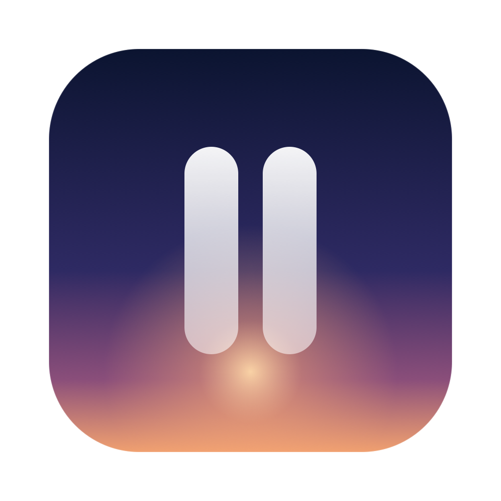

<p align="center">
  
</p>

<h1 align="center">Interlude</h1>

<p align="center">A calm, glanceable screen for your Mac while you step away.</p>

When your Mac has been idle for a few minutes, Interlude fills the screen with one of Apple's aerial
videos and a set of glass cards: a large clock, the weather, your reminders, world clocks, a focus timer
and your waiting notifications. When music is playing, the album art becomes the background. Press Esc
or click the wallpaper to go back to work.

## Features

- **Clock** in your choice of font and colour, with a night mode that dims everything to one tint.
- **Weather** for your approximate location, with the next few hours.
- **Reminders** from your default list. Click a circle to complete one.
- **World clock** with four cities.
- **Focus timer** that keeps running while Interlude is closed.
- **Now playing** for Music and Spotify. Space plays or pauses, ← and → skip tracks.
- **Notifications** still waiting in Notification Center, one pill per app.
- **Aerial wallpapers** from System Settings › Wallpaper. Downloaded aerials play from disk.
- **Start rules**: start only while charging, wait during video calls or screen sharing, pick a display.

Interlude lives in the menu bar. It has no Dock icon.

## Requirements

- macOS 15 or later
- Xcode command line tools (Swift 6)

## Build

```bash
./build.sh
```

This builds `build/Interlude.app`. Move it to `/Applications` and open it.

The script signs the app with a local signing identity if you have one, and otherwise with an ad-hoc
signature. With an ad-hoc signature, macOS may ask for permissions again after each rebuild.

Run the tests with:

```bash
swift test
```

## Permissions

Each permission turns on one card. Everything else works without it.

| Permission | Used for |
| --- | --- |
| Reminders | Showing and completing reminders |
| Calendars | Your next event and today's date |
| Automation (Music, Spotify) | Reading the current track and controlling playback |
| Location | Local weather |
| Full Disk Access | Reading Notification Center's database for notification pills |

## Privacy

Interlude has no accounts, analytics or servers of its own. It makes two kinds of network request:

- Weather comes from [Open-Meteo](https://open-meteo.com). The request includes your approximate
  latitude and longitude.
- Aerials you haven't downloaded stream from Apple, the same way System Settings plays them.

Notification pills read Notification Center's private database. Its format is undocumented, so a macOS
update can break that card until Interlude is updated.

## Credits

- Fonts: [Instrument Serif](https://github.com/Instrument/instrument-serif) and
  [DM Mono](https://github.com/googlefonts/dm-mono), under the SIL Open Font License
  (see [Fonts/OFL.txt](Fonts/OFL.txt)).
- Aerial videos and SF Symbols belong to Apple and are not part of this repository.

Interlude is an independent project and is not affiliated with Apple.

## License

[MIT](LICENSE)
