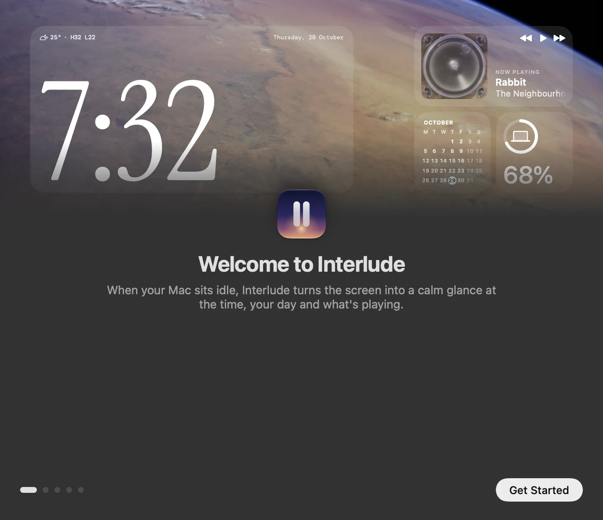
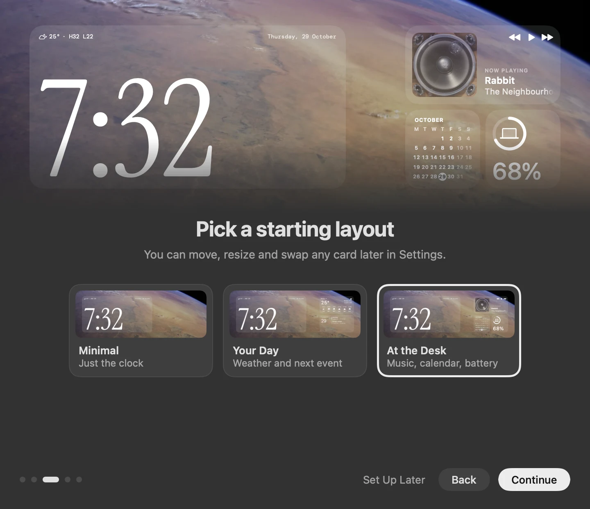
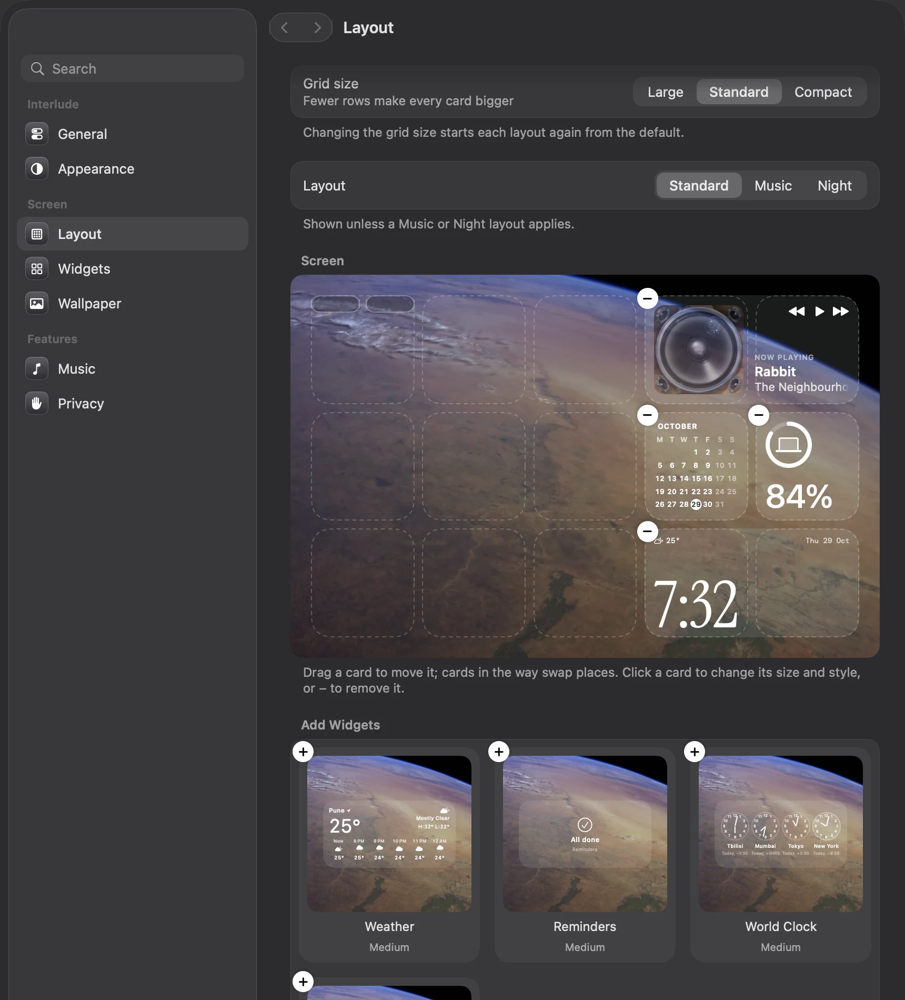
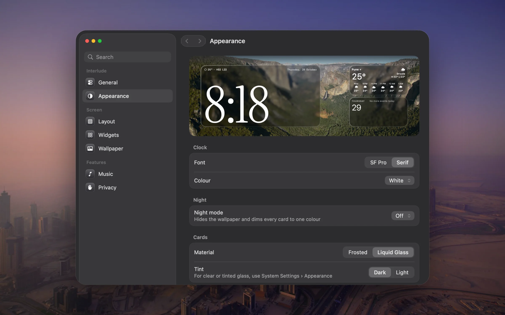

<p align="center">
  
</p>

<p align="center">
  
  
  
  
</p>

---

## What is this?

When your Mac has been idle for a few minutes, Interlude fills the screen with one of Apple's aerial
videos and a set of glass cards: a large clock, the weather, your calendar and reminders, world
clocks, a focus timer and what's playing. When music is playing, the album art can become the
background. Move the mouse, press Esc or click the wallpaper to go back to work.

It's StandBy for the Mac: something worth glancing at from across the room, instead of a black screen.

## See it

<p align="center">
  
</p>

<table>
<tr>
<td width="55%"></td>
<td><b>A short welcome</b><br><br>Five quick steps on first launch: when Interlude starts, a starting layout, and which cards may read your calendar, reminders, location and music. Every step can be skipped, and Settings › Privacy can show it again.</td>
</tr>
<tr>
<td></td>
<td><b>Pick a layout</b><br><br>Minimal, Your Day or At the Desk. Each thumbnail is drawn with the real cards, so what you pick is what you get.</td>
</tr>
<tr>
<td></td>
<td><b>Your screen, your way</b><br><br>Drag cards around a miniature of your screen, resize them, pick a style for each, or add more from the gallery. Separate layouts can take over while music plays or at night.</td>
</tr>
<tr>
<td></td>
<td><b>Appearance</b><br><br>Clock font and colour (including one that matches the album art), a night mode that dims everything to red or grey, and frosted or Liquid Glass cards. The preview above updates as you change things.</td>
</tr>
</table>

<sub>Screenshots are rendered by the app itself with sample data. On screen, the cards and windows are see-through glass.</sub>

## Features

- **Clock** in four sizes and several styles, in SF Pro or a serif, in white, a custom colour or the album's colour.
- **Weather** for your approximate location, now and for the next hours or days.
- **Calendar**: a month, today's agenda or the next event, plus a pill for what's next.
- **Reminders** from your default list. Click a circle to complete one.
- **Now playing** for Music and Spotify. Space plays or pauses, ← and → skip tracks.
- **World clock** with four cities, and a **focus timer** that keeps running while Interlude is closed.
- **Battery** for your Mac and connected devices.
- **Night mode** on a schedule or always: no wallpaper, every card dimmed to red or grey.
- **Aerial wallpapers** from System Settings › Wallpaper. Downloaded aerials play from disk.
- **Start rules**: only while charging, wait during video calls or films, choose a display.

Interlude lives in the menu bar. It has no Dock icon.

## Requirements

- macOS 15 or later (Liquid Glass cards need macOS 26)
- Xcode command line tools (Swift 6)

## Build

```bash
./build.sh
```

This builds `build/Interlude.app`. Move it to `/Applications` and open it.

The script signs the app with a local signing identity if you have one, and otherwise with an ad-hoc
signature. With an ad-hoc signature, macOS may ask for permissions again after each rebuild.

Run the tests with:

```bash
swift test
```

## Permissions

Each permission turns on one card. Everything else works without it.

| Permission | Used for |
| --- | --- |
| Calendars | Your next event and today's agenda |
| Reminders | Showing and completing reminders |
| Location | Local weather |
| Automation (Music, Spotify) | Reading the current track and controlling playback |

## Privacy

Interlude has no accounts, analytics or servers of its own. It makes two kinds of network request:

- Weather comes from [Open-Meteo](https://open-meteo.com). The request includes your approximate
  latitude and longitude.
- Aerials you haven't downloaded stream from Apple, the same way System Settings plays them, and so
  do their preview stills in Settings › Wallpaper.

## Credits

- Fonts: [Instrument Serif](https://github.com/Instrument/instrument-serif) and
  [DM Mono](https://github.com/googlefonts/dm-mono), under the SIL Open Font License
  (see [Fonts/OFL.txt](Fonts/OFL.txt)).
- Aerial videos and stills and SF Symbols belong to Apple and are not part of this repository.

Interlude is an independent project and is not affiliated with Apple.

## License

[MIT](LICENSE)
