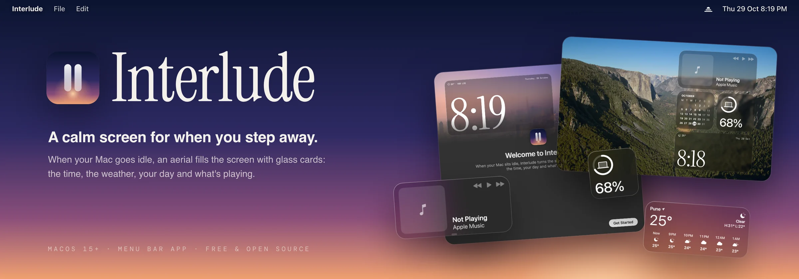
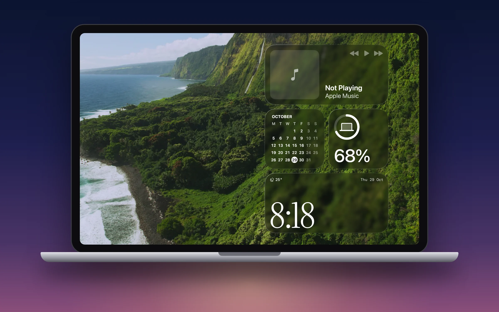
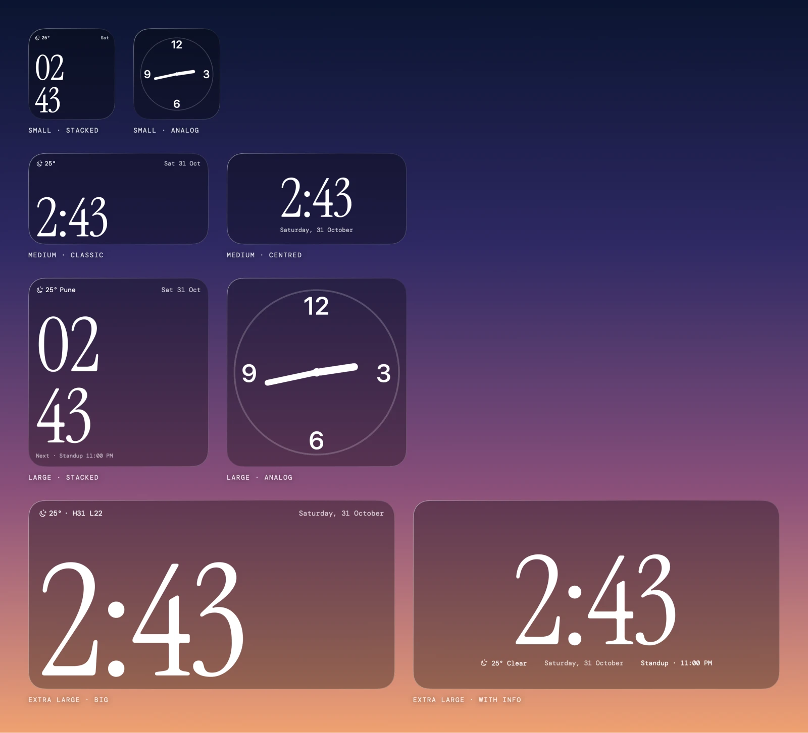
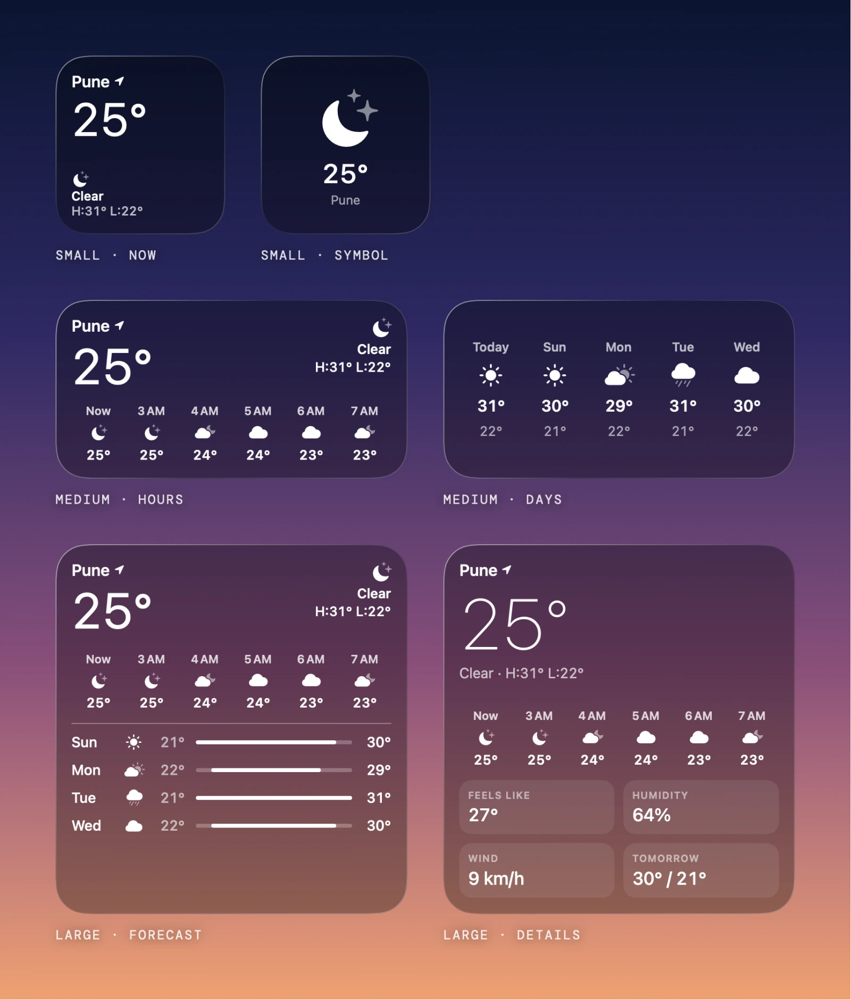
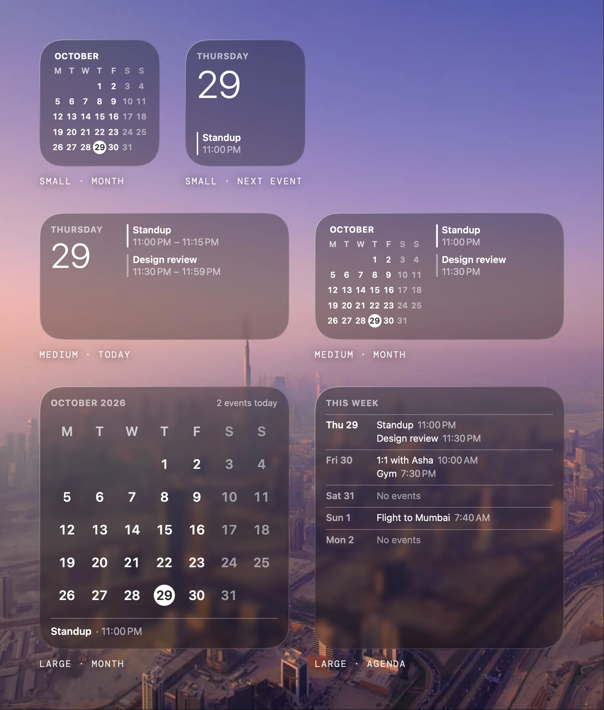
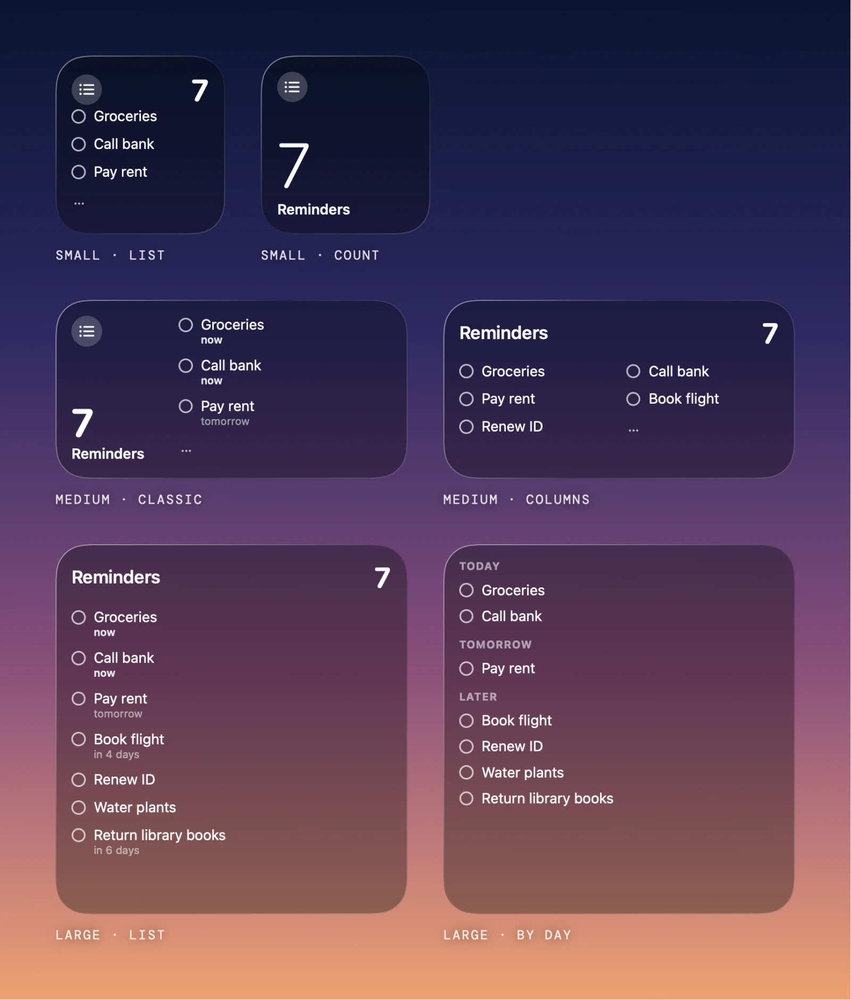
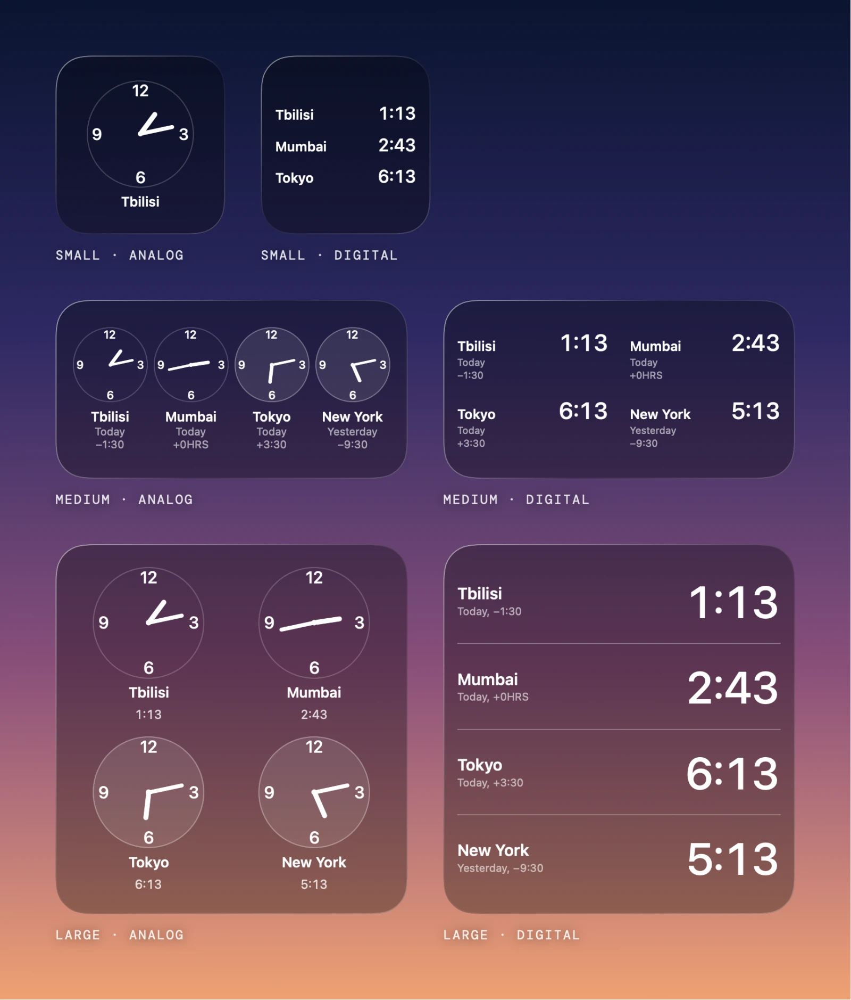
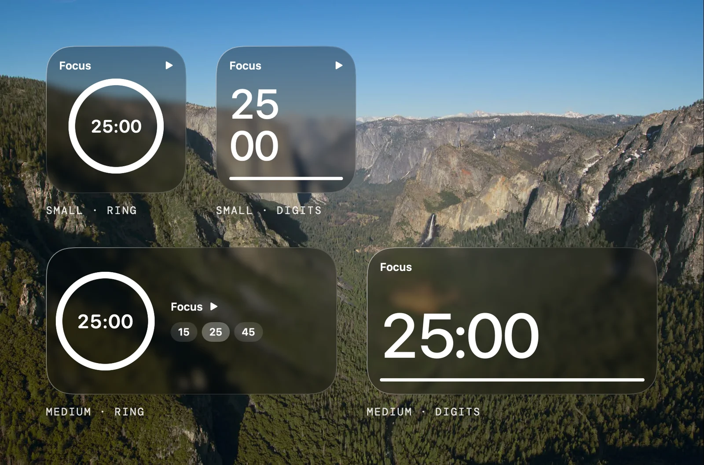
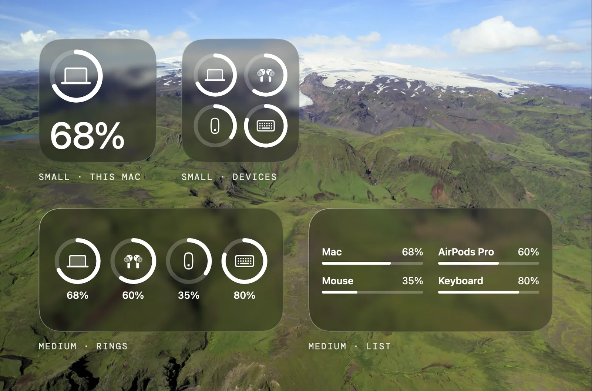
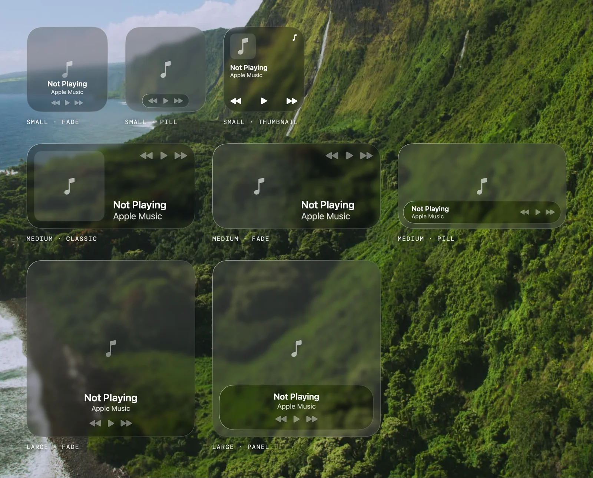

<p align="center">
  
</p>

<p align="center">
  
  
  
  
</p>

---

## The screensaver Apple never made

Apple's aerial screensavers are some of the best footage ever put on a Mac, and all they show you is
the view. Interlude keeps the view and adds what you'd want to glance at from across the room: the
time, the weather, your day, what's playing. Glass widgets, in the style of macOS, over the same aerials.

It starts when your Mac has been idle for a few minutes. Move the mouse, press Esc or click the
wallpaper, and you're back.

<p align="center">
  
</p>

## Widgets

Eight widgets, each in two to four sizes and two or three styles. Place them anywhere on a grid that
fits your screen, and keep separate layouts for when music plays and for night.

### Clock

SF Pro or a serif, in white, a colour you pick or the colour of the album playing. Digital or analog,
from a small square to the full width of the screen.



<table>
<tr>
<td width="50%" valign="top">
<h3>Weather</h3>
Now, the next hours, the week ahead or the details, for your approximate location.
<br><br>

</td>
<td width="50%" valign="top">
<h3>Calendar</h3>
The month, today's events, the next one up, or an agenda for the week.
<br><br>

</td>
</tr>
<tr>
<td valign="top">
<h3>Reminders</h3>
Your default list, by due date or in columns. Click a circle to complete one.
<br><br>

</td>
<td valign="top">
<h3>World Clock</h3>
Four cities of your choice, as clock faces or digits.
<br><br>

</td>
</tr>
<tr>
<td valign="top">
<h3>Focus Timer</h3>
Click to start, right-click to reset. It keeps running while Interlude is closed and chimes when it ends.
<br><br>

</td>
<td valign="top">
<h3>Battery</h3>
Your Mac, AirPods, mouse and keyboard, as rings or a list.
<br><br>

</td>
</tr>
</table>

### Now Playing

Apple Music and Spotify. Space plays or pauses, ← and → skip. While music plays, the album art can
take over the background. When nothing plays, the widget says so.



<sub>Every picture here is drawn by the app itself, with sample data.</sub>

## And everything around them

- **Liquid Glass or frosted** widgets, dark or light, with the blur and tint you like.
- **Your own mix of aerials** from System Settings › Wallpaper. Tick whole groups or single aerials;
  they shuffle, and none repeats until every one has played.
- **Night mode** on a schedule or always: the wallpaper goes dark and every widget dims to red or grey.
- **Start rules**: only while charging, wait during video calls and films, pick the display.
- **Lives in the menu bar**, with no Dock icon.

## What's new in 0.2

- **Wallpaper:** pick any mix of aerials with checkmarks instead of one aerial or one group. Groups fold
  away, and the shuffle plays each pick once before any repeat, even across restarts.
- **Clock faces:** analog clocks show only 12, 3, 6 and 9, with shorter hands that no longer cover
  the numbers, and no second hand.
- **Widgets:** Reminders end with "…" when more are waiting, the Columns style gets its title and
  count, Weather Details shows the next hours, and every Focus Timer style has a play button.
- **Now Playing:** with no music playing, the buttons that would do nothing are dimmed.
- **Settings and welcome:** previews fade between looks, the World Clock offset no longer gets cut
  off, and the welcome window centres its text.
- **Lighter on your Mac:** the widgets redraw only when what they show changes. Clocks tick once a
  minute, the music background is capped at 30 fps, and the background timers stop while Interlude
  is closed.

## Download

Get `Interlude-0.2.dmg` from [Releases](https://github.com/codezeroexe/interlude/releases), open it
and drag Interlude to Applications.

The app isn't notarized by Apple, so the first time you open it macOS says it can't check it for
malware. Click Done, then go to System Settings › Privacy & Security and click **Open Anyway** next
to Interlude. You only need to do this once.

## Requirements

- macOS 15 or later (Liquid Glass cards need macOS 26)
- Xcode command line tools (Swift 6)

## Build

```bash
./build.sh
```

This builds `build/Interlude.app`. Move it to `/Applications` and open it.

The script signs the app with a local signing identity if you have one, and otherwise with an ad-hoc
signature. With an ad-hoc signature, macOS may ask for permissions again after each rebuild.

Run the tests with (this needs Xcode, not only the command line tools):

```bash
swift test
```

## Permissions

Each permission turns on one card. Everything else works without it.

| Permission | Used for |
| --- | --- |
| Calendars | Your next event and today's agenda |
| Reminders | Showing and completing reminders |
| Location | Local weather |
| Automation (Music, Spotify) | Reading the current track and controlling playback |

## Privacy

Interlude has no accounts, analytics or servers of its own. It makes two kinds of network request:

- Weather comes from [Open-Meteo](https://open-meteo.com). The request includes your approximate
  latitude and longitude.
- Aerials you haven't downloaded stream from Apple, the same way System Settings plays them, and so
  do their preview stills in Settings › Wallpaper.

## Credits

- Fonts: [Instrument Serif](https://github.com/Instrument/instrument-serif) and
  [DM Mono](https://github.com/googlefonts/dm-mono), under the SIL Open Font License
  (see [Fonts/OFL.txt](Fonts/OFL.txt)).
- Aerial videos and stills and SF Symbols belong to Apple and are not part of this repository.

Interlude is an independent project and is not affiliated with Apple.

## License

[MIT](LICENSE)
